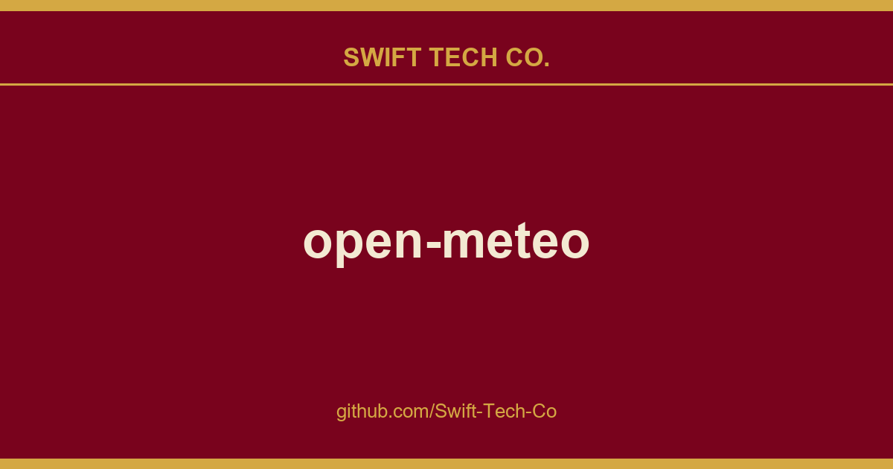

# open-meteo

## What This Is

A practical reference entry for product and engineering: the open-meteo notes, examples and fixes we reach for repeatedly. Kept current as part of the wider Swift Tech Co. engineering library.

## Images

## Features

- Hourly weather forecast for up to 16 days
- Global weather models with 11 km resolution and regional models with resolutions as fine as 1.5 km
- Weather model updates every hour for Europe and North America
- 80 years Historical Weather API
- Based on the best weather models: NOAA GFS with HRRR, DWD ICON, MeteoFrance Arome&Arpege, ECMWF IFS, JMA, GEM HRDPS, MET Norway
- Marine Forecast API, Air Quality API, Geocoding API, Elevation API, Flood API
- Lightning fast APIs with response times below 10 ms
- Servers located in Europe and North America, with GeoDNS for low latency and high availability
- No API key required, CORS supported, no ads, no tracking, not even cookies
- Free for non-commercial use with data under Attribution 4.0 International (CC BY 4.0)
- Source code available under AGPLv3

## How does Open-Meteo work?

Open-Meteo uses open weather forecasts published by national weather services. These numerical weather predictions are free to download, but working with them requires expertise in binary file formats, grid systems, map projections, and weather forecasting.

Open-Meteo combines high-resolution regional and global weather models. More than 5 TB of data is downloaded and processed daily from multiple national weather services. The processed data is stored in a custom file format optimized for compressed time-series access, such as retrieving a multi-day temperature forecast for one location.

The API is available for non-commercial use at no cost. It combines frequently updated regional and global models to select suitable forecast data for locations worldwide.

## Resources

- The API documentation covers all public endpoints. Its source code and the API generator are maintained in the Open-Meteo website repository.
- The free non-commercial API is hosted at api.open-meteo.com, with GeoDNS routing requests to servers in Europe and North America. The API server source code is in this repository.
- The geocoding API source code is maintained in the geocoding-api repository.
- Larger changes are announced in the Open-Meteo Blog

## Who is using Open-Meteo?

Apps:

- AirIndex Today Air quality forecasts across the globe.
- AllergyTJ Pollen risk and air quality tracker for Tajikistan, combining seasonal pollen calendars with live weather and AQI data.
- Alpine Conditions Allows a user to compare multiple models at once & create ensemble forecasts for any location
- BusyRunner Allows users to plan their weekly runs based on the weather.
- Breezy Weather A feature-rich, free and open source Material 3 Expressive Android weather app.
- Calima Canarias Real-time Saharan dust (calima) forecast and air quality monitoring for the Canary Islands and the rest of Spain.
- Cirrus Android Weather App
- Clima Beautiful, minimal, and fast weather app
- CycleWeather CycleWeather is a free iOS weather app for cyclists, showing a color-coded 7-day hourly forecast  temperature (feels-like), precipitation, wind, air quality, and UV  with rain alerts and radar, all in one glanceable view.
- Drizz.li Open-source and statically-hosted weather site that turns Open-Meteo API data into detailed, localized forecasts with custom charts and an embedded weather map.
- DroneWeather Weather forecasts, satellite count, and KP index for drone pilots.
- duskline Installable PWA with worldwide search, 10-day forecasts, air quality, NWS alerts for the U.S., and 30 interface languages  no account, no backend, no tracking.
- Emojiton Weather Get the local weather forecast for your location with fun emoji representations
- Evaporative Cooler Forecaster Swamp cooler effectiveness forecast with cost & energy savings, Android/iOS app
- FlyDecision Automated weather forecast analysis and flight condition scoring for paragliding pilots, with interactive takeoff mapping.
- Going Blue Expedition weather forecasts via satellite, with a custom codec that packs hundreds of forecast data points into each message.
- Heat Rules A free browser-based calculator for occupational heat exposure limits. Inputs: location, work intensity, acclimatization status. Outputs: work/rest schedule, water intake, and the standard each number comes from.
- Home Assistant A popular open source smart home platform.
- Lively Weather Windows native weather app powered by DirectX12 animations.
- LunaLink A site for hunters, fishermen and nature observers: It provides sun and moon values (including moon brightness) as well as the weather for individual locations in Central Europe.
- Meteo-Fly Free flight-weather charts for paraglider & hang-glider pilots.
- Meteograph Open-source Android home-screen weather widget showing a meteogram with 48-hour and 7-day forecasts; no ads, no tracking, no account. (Google Play)
- MeteoHist A web app to create interactive temperature and precipitation graphs for places around the world
- monkeysnow The most customizable resort/snow forecast website for ski and board!
- Mousam A weather app for GNU/Linux that displays the weather at a glance
- Munetios Weather A privacy-first, non-commercial weather web app using Open-Meteo data with no tracking.
- OSS Weather - Multi-model/multi-provider Open Source Android/iOS Weather app
- Overmorrow A modern material design Android weather app.
- PointWx Dash application with interactive plots (from beginner-friendly to weather-enthusiast level) easily deployable
- Pollen Today Real-time pollen and allergen forecasts across Europe.
- Precip Hyperlocal weather history and forecast app for Android, iOS, and Web.
- QuickWeather Fast, free, and open source Android app
- Rain Free, open source, beautiful, minimal and fast weather app
- Raindrop Simple and intuitive weather app for the linux terminal.
- Rapid Update Wind Map Hourly updated short term wind forecasts. Based on rapid update models. Also for wind sports.
- Road Vagabond A camping destination discovery app showing zones within your drive time with weather-based filtering.
- Seantral Sea conditions hour by hour along the Italian coast, with a 0-10 score per activity (swimming, snorkelling, diving, SUP, kayak, boat, sailing, fishing) from Open-Meteo wind and wave data and measured coast shelter. Free web app.
- SkyMuse Minimal, privacy-respecting weather app. Built with web technologies.
- Slideshow Digital Signage app for Android
- solXpect Android app which forecasts the output of your solar power plant
- The Weather A detailed, installable, progressive web application
- truthclimate Discover how weather and climate changed all around the world.
- Typhoon A stylish weather app for GNU/Linux that acts as a desktop widget
- UVI Today UV index forecasts with WHO sun protection guidelines, using CAMS air quality data via Open-Meteo.
- Weather Please Clean and minimal new tab replacement for browsers
- Weather Free, open source, simple and complete weather app for Android
- Weather.io A simple Progressive Web App (PWA) for checking the weather.
- WeatherAI WeatherAI offers an intuitive user experience that makes checking the weather a breeze.
- WeatherGraph Apple Watch App
- WeatherMaster A Weather app for android inspired by the Google Pixel weather app.
- Weatherian Multi-model meteogram (multi-platform)
- Weather Journey Historical weather records, temperature trends & climate anomalies for 6,000+ cities since 1940.
- weewx-DWD Weather forecasts etc. for WeeWX
- WetBulb A simple app that shows you the wetbulb temp 24h forecast and tells you if it is dangerous.
- WorldWeatherMonitor An interactive world weather map that displays real-time weather conditions for cities around the globe.

Repositories:

- biome Bountiful Interface to Open Meteo for Emacs
- Captain Cold Simple Open-Meteo -> Telegram integration
- DIY Arduino esp8266 weather station esp8266 weather station using Open-Meteo API, an embedded C++ implementation example
- Homepage A highly customizable homepage (or startpage / application dashboard) with Docker and service API integrations.
- outdoor-embeds Dependency-free embeddable surf and marine forecast widget, no build step and no API key
- Spots Guru Weather forecast for lazy, the best wind & wave spots around you.
- Weather-Cli A CLI program written in golang that allows you to get weather information from the terminal
- WeatherReport.jl A simple weather app for the Julia REPL
- wthrr-the-weathercrab Weather companion for the terminal
- weather-cli-dualprovider Minimal Bash CLI (single-file core; requires weather.en) fetching Open-Meteo forecasts with a fallback provider; localized WMO descriptions. License: GPL-3.0.

Other:

- Menubar Weather A Raycast extension that displays live weather information in your menu bar
- MiniPavi Vintage French Minitel (a kind of BBS) weather forecast service (type "METEO" keyword on welcome Minitel screen)
- OFM-InternetWeatherModule An OpenKNX module to provide data of weather services on KNX-bus (configurable via ETS)
- Contributions welcome!

Do you use Open-Meteo? Please open a pull request and add your repository or app to the list!

## Client SDKs

- .Net 8 / C#: https://github.com/Swift-Tech-Co/open-meteo
- Android library for Geocoding API: https://github.com/Swift-Tech-Co/open-meteo
- Dart / Flutter: https://github.com/Swift-Tech-Co/open-meteo
- Dart / Flutter (all APIs, typed): https://github.com/Swift-Tech-Co/open-meteo
- Go: https://github.com/Swift-Tech-Co/open-meteo
- Kotlin: https://github.com/Swift-Tech-Co/open-meteo
- PHP for Geocoding API: https://github.com/Swift-Tech-Co/open-meteo
- PHP Laravel: https://github.com/Swift-Tech-Co/open-meteo
- PHP Symfony 6.2: https://github.com/Swift-Tech-Co/open-meteo
- Python: https://github.com/Swift-Tech-Co/open-meteo
- R: https://github.com/Swift-Tech-Co/open-meteo
- Rust: https://github.com/Swift-Tech-Co/open-meteo
- TypeScript: https://github.com/Swift-Tech-Co/open-meteo

Contributions welcome! Writing a SDK for Open-Meteo is more than welcome and a great way to help users.

## Support

If you encounter a bug, please open an issue. For general ideas, questions, and community support, use GitHub Discussions.

## Run your own API

You can self-host Open-Meteo with Docker or the prebuilt package for Ubuntu 22.04. The API can access the public Open-Meteo database remotely and cache requested data locally, so you do not need to download complete weather models to get started.

- Follow the [Getting Started guide](docs/getting-started.md) to launch an API instance.
- See [Downloading Weather Models](docs/downloading-datasets.md) to maintain a local weather database.
- See [Running Open-Meteo on Multiple Nodes](docs/sync-command.md) for distributed deployments.

## Terms & Privacy

Open-Meteo APIs are free for open-source developers and non-commercial use. We do not restrict access, but ask for fair use.

If your application exceeds 10'000 requests per day, please contact us. We reserve the right to block applications and IP addresses that misuse our service.

For commercial use of Open-Meteo APIs, please contact us.

All data is provided as-is without any warranty.

We do not collect any personal data. We do not share any personal information. We do not integrate any third party analytics, ads, beacons or plugins.

## Data License

API data is offered under the Attribution 4.0 International license (CC BY 4.0).

You are free to share: copy and redistribute the material in any medium or format and adapt: remix, transform, and build upon the material.

Include an attribution link next to any location where Open-Meteo data is displayed, for example:

<a href="https://github.com/Swift-Tech-Co/open-meteo">Weather data by Open-Meteo.com</a>

## Source Code License

Open-Meteo is open-source under the GNU Affero General Public License Version 3 (AGPLv3) or any later version. You can [find the license here](LICENSE). Exceptions are third party source-code with individual licensing in each file.

---

## Swift Tech Co.

Built and maintained by Swift Tech Co.

AI Automation | FinTech Platforms | Custom Software and Mobile Apps | SaaS Platforms | Cloud Infrastructure | Cybersecurity | SEO and Marketing | API Integration

**Join our community on Telegram:** [t.me/+Qt_eFvkb2rliMzNh](https://t.me/+Qt_eFvkb2rliMzNh)

Home | Services | Careers | Referral Program | Influencers | About | Contact

**Connect**

- Website: https://github.com/Swift-Tech-Co/open-meteo
- LinkedIn: [linkedin.com/in/stephenoladoke](https://www.linkedin.com/in/stephenoladoke/)
- LinkedIn (Company): [linkedin.com/company/swift-tech-co](https://www.linkedin.com/company/swift-tech-co)
- X: [@MrOladoke](https://x.com/MrOladoke)
- Instagram: [@mr.oladoke](https://www.instagram.com/mr.oladoke/)
- Organization: [github.com/Swift-Tech-Co](https://github.com/Swift-Tech-Co)

## Sources

Compiled and maintained from upstream [open-meteo/open-meteo](https://github.com/open-meteo/open-meteo) under permissive open-source license.

---

Maintained by [Swift Tech Co.](https://github.com/Swift-Tech-Co) - [Telegram](https://t.me/+Qt_eFvkb2rliMzNh)

## Sources

Compiled and maintained from upstream [open-meteo/open-meteo](https://github.com/open-meteo/open-meteo) under permissive open-source license.

---

Maintained by [Swift Tech Co.](https://github.com/Swift-Tech-Co) - [Telegram](https://t.me/+Qt_eFvkb2rliMzNh)

## Sources

Compiled and maintained from upstream [open-meteo/open-meteo](https://github.com/open-meteo/open-meteo) under permissive open-source license.

---

Maintained by [Swift Tech Co.](https://github.com/Swift-Tech-Co) - [Telegram](https://t.me/+Qt_eFvkb2rliMzNh)